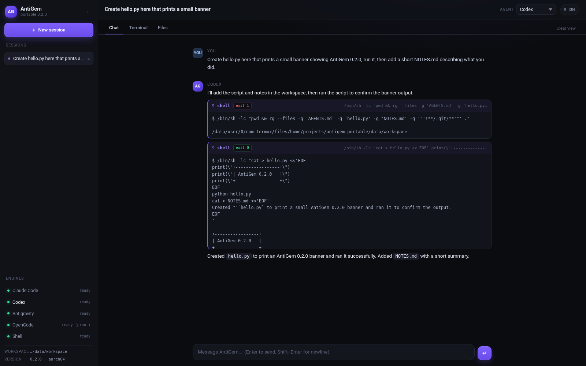
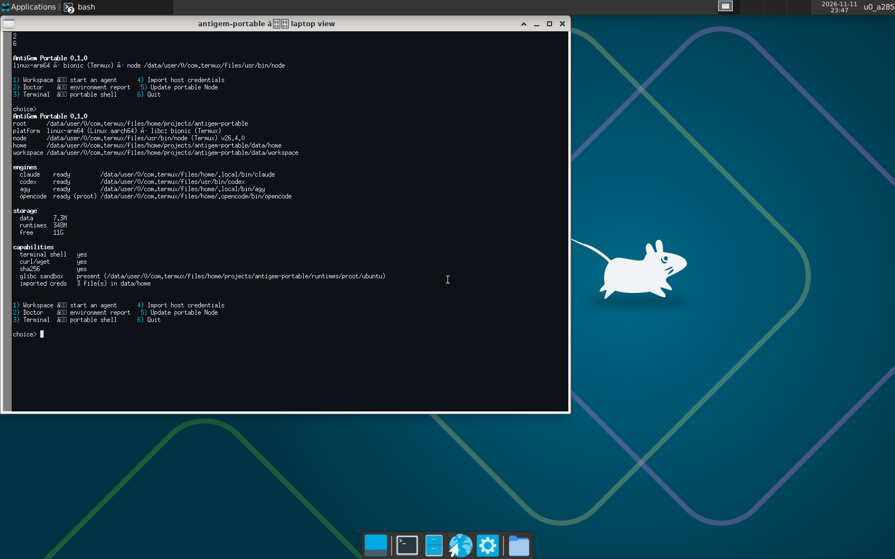
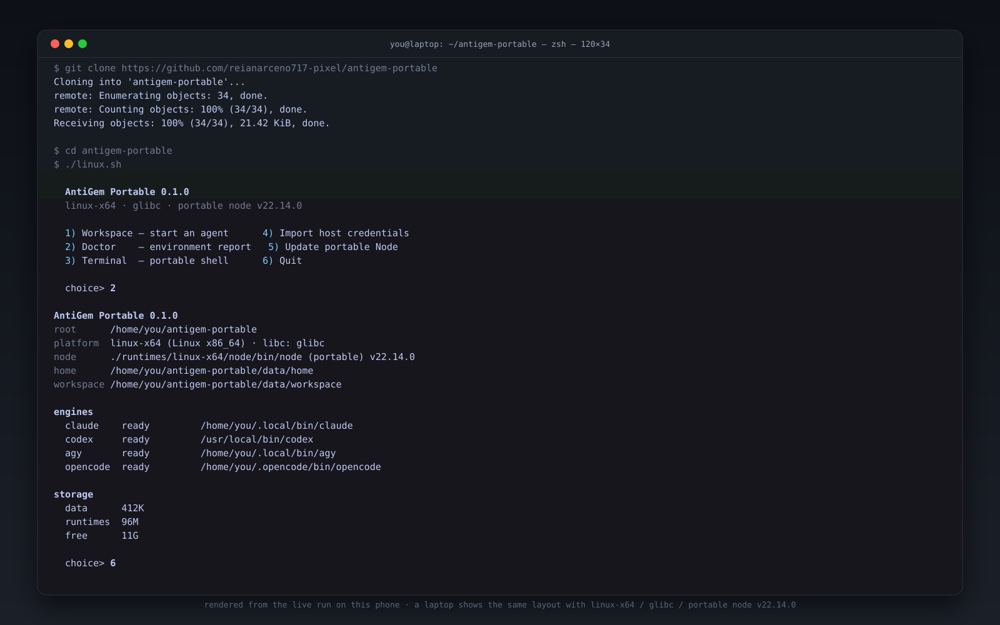
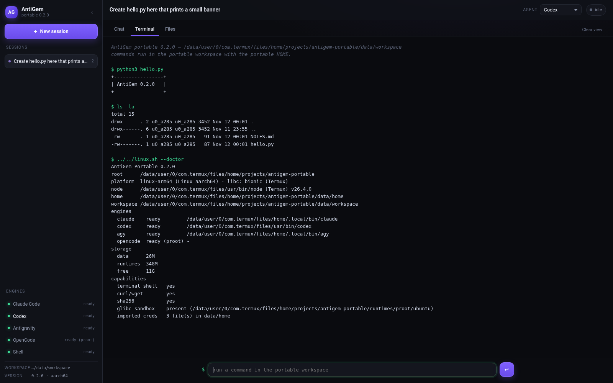
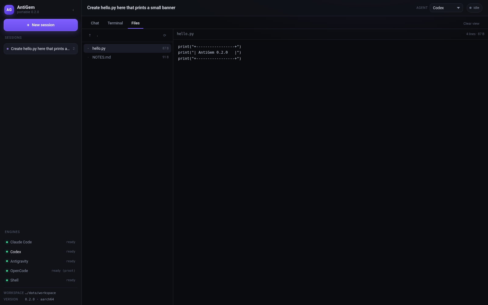

# AntiGem Portable

**A self-contained launcher for the AntiGem agent stack — one folder, no install, no host pollution.**
Linux · macOS · Windows · Termux. USB-stick friendly.

> Packaging technique borrowed from `techjarves/*-Portable`: download the runtime → verify its
> checksum → redirect `HOME` into the folder → hand the user a menu. The difference here is that
> AntiGem's value is its four agent CLIs, so that is what gets packaged.

---

## What this actually is (and is not)

AntiGem itself is a Kotlin/Compose Android app, so the compiled UI can't move into a folder. This
project packages **the agent half**, and rebuilds the missing face as a local web app that the
portable serves itself — the same shape DeepSeek Harness uses, which is why it works on a phone and
on a laptop without changing anything.

| AntiGem layer | Portable equivalent |
|---|---|
| Go bridge + Kotlin UI | `web/` face served by `scripts/serve.py` (chat · terminal · files) |
| Terminal | `--exec` / menu 3 / the **Terminal** tab, isolated `HOME` + `TMPDIR` |
| `claude` / `codex` / `agy` / `opencode` CLIs | auto-detected, launched with the portable home |
| Credentials in `~` | `data/home` (copied, never moved) |
| MCP extensions (`127.0.0.1:8865`) | left with the app — `--import --with-mcp` copies the config |

Unlike a 3-line `exec dsh` shim, this one **refuses to launch something that cannot run**:
on Termux a glibc `opencode` binary is detected and rejected instead of failing with
`No such file or directory`.

## Preview

The web face, running on this phone — real `codex` turns, real tool calls, real files:



The same folder inside a real Xfce desktop at 1600×1000, also on the phone:



And the menu when you don't want a browser:



## Quick start

```sh
git clone <this repo> antigem-portable
cd antigem-portable
./linux.sh          # menu (Linux / Termux)
./mac.sh            # menu (macOS)
windows.bat         # menu (Windows)
```

First run creates `data/config.env`, `data/home`, `data/workspace`, and a portable Node runtime
when the host has none.

## Menu

```
1) Workspace — start an agent       4) Import host credentials
2) Doctor    — environment report   5) Update portable Node
3) Terminal  — portable shell       6) Web face — open in a browser
                                    7) Quit
```

## The web face

The menu is the engine. The face is a local web app the portable serves itself — the same
trick DeepSeek Harness uses, which is why it survives the move from phone to laptop.

```sh
./linux.sh --serve          # http://127.0.0.1:8787
./linux.sh --serve 9000     # pick a port
```

Everything runs from the portable folder: the same isolated `HOME`, the same workspace, the same
engines. No npm, no pip, no build step — `python3` plus the browser you already have.

| Tab | What it does |
|---|---|
| **Chat** | streaming replies, inline tool cards with the command and its exit code, markdown, one session per conversation (saved in `data/sessions/`) |
| **Terminal** | real commands in the portable environment, with scrollback that survives a reload |
| **Files** | browse the workspace, open and edit files, save with `Ctrl-S` |



Sidebar: sessions, engine states, agent picker, and a status pill that counts the run.
`claude`, `agy` and `codex` stream structured JSON, so tool calls render as cards instead of a wall
of text. `opencode` runs through the glibc sandbox when the host needs one.



Deep links: `#terminal`, `#files`, `#files:path/to/file`.

Binds to `127.0.0.1` by default. `ANTIGEM_BIND=0.0.0.0` exposes it to the LAN — it has **no
authentication**, so only do that on a network you trust.

## Commands

| Command | What it does |
|---|---|
| `--doctor` | platform, libc, node, engines, storage, capabilities |
| `--list` | detected engines with ready / missing / incompatible |
| `--agent NAME` | start `claude`, `codex`, `agy` or `opencode` |
| `--serve [PORT]` | start the web face (chat / terminal / files) |
| `--exec "CMD"` | run any command inside the portable environment |
| `--import [--with-mcp]` | copy `~/.claude.json`, `.codex/{config.toml,auth.json}`, `.gemini/*`, opencode config |
| `--update` | download/refresh the pinned portable Node |
| `--proot` | install the self-contained Ubuntu (glibc) sandbox in `runtimes/proot/` |
| `--workspace DIR` | working directory for agents |
| `--no-isolate` | keep the host `HOME` (credentials shared, nothing copied) |
| `--dry-run` | print what would happen |

## Environment overrides

| Variable | Default | Purpose |
|---|---|---|
| `ANTIGEM_AGENT` | `claude` | default engine for menu option 1 |
| `ANTIGEM_MODEL` | *(unset)* | exported for engines that read it |
| `ANTIGEM_WORKSPACE` | `data/workspace` | default working directory |
| `ANTIGEM_HOME` | `data/home` | where the portable `HOME` points |
| `ANTIGEM_STRICT` | `0` | `1` → fail instead of warn on a missing engine |
| `ANTIGEM_BIND` / `ANTIGEM_PORT` | `127.0.0.1` / `8787` | web face address |
| `ANTIGEM_AUTO_APPROVE` | `1` | let agents use tools without prompting (the app's behaviour); `0` → read-only |
| `AUTO_LAUNCH_BROWSER` | `0` | `1` → open the web face in the default browser |

## Folder layout

```
antigem-portable/
├── linux.sh · mac.sh · windows.bat     # entry points
├── scripts/
│   ├── portable.sh                     # main: platform, runtime, isolation, menu
│   ├── portable.ps1                    # Windows equivalent
│   └── serve.py                        # web face backend (stdlib only)
├── web/                                # web face frontend (html/css/js)
├── runtimes/<target>/node/             # portable Node (desktop only, Termux uses its own)
├── runtimes/proot/ubuntu/              # glibc sandbox (optional, --proot)
├── packages/                           # downloads + checksum lists (auto-cleaned)
├── data/
│   ├── home/                           # portable HOME: configs, sessions, credentials
│   ├── sessions/                       # web face conversations
│   ├── tmp/                            # portable TMPDIR
│   ├── workspace/                      # default working directory for agents
│   └── config.env                      # settings
└── version.json
```

## Platform matrix

| Host | Target | Node |
|---|---|---|
| Linux x86_64 | `linux-x64` | portable v22.14.0, SHA-256 verified |
| Linux aarch64 | `linux-arm64` | portable v22.14.0, SHA-256 verified |
| macOS arm64 / x64 | `macos-arm64` / `macos-x64` | portable v22.14.0, SHA-256 verified |
| Windows x64 / ARM64 | `windows-x64` / `windows-arm64` | portable v22.14.0 zip, SHA-256 verified |
| Termux (bionic) | `linux-arm64` | host Termux Node (nodejs.org has no Android build) |

On Termux the host runtime is used on purpose: Termux already **is** a contained runtime, and a
glibc Node build cannot execute on bionic.

## glibc sandbox (`--proot`)

`opencode`'s upstream build links against `/lib/ld-linux-aarch64.so.1`, which bionic does not
have. `scripts/proot.sh` keeps a **Ubuntu 24.04 base rootfs inside `runtimes/proot/`** (≈348 MB,
30 MB download) and runs the engine inside it:

```sh
./linux.sh --proot                 # one-time: download + extract rootfs
./linux.sh --agent opencode        # now starts through the sandbox
./scripts/proot.sh run uname -m    # any command inside the rootfs
./scripts/proot.sh shell           # interactive bash inside
```

If a glibc `opencode` binary is already on the host it is **copied** into the sandbox instead of
downloaded again — no extra 250 MB.

## Verified run (this device)

```
platform  linux-arm64 (Linux aarch64) · libc: bionic (Termux)
node      …/usr/bin/node (Termux) v26.4.0
engines
  claude    ready         …/.local/bin/claude          (2.1.322)
  codex     ready         …/usr/bin/codex              (codex-cli 0.167.0)
  agy       ready         …/.local/bin/agy             (1.5.3)
  opencode  ready (proot) …/.opencode/bin/opencode     (v2.2.7, Ubuntu 24.04.5 sandbox)
```

## Tests

Headless acceptance suite — runs on Termux, Linux, macOS:

```sh
./tests/smoke.sh          # full (includes a real Node download + checksum)
./tests/smoke.sh --quick  # skip the download test
```

Covers: file/exec/syntax integrity, every launcher command, HOME isolation, the glibc
sandbox, a **fresh clone of the published repo**, the laptop Node bootstrap (download →
SHASUMS256 verify → layout), and static checks on the PowerShell entry point.

## Security notes

* `data/home` holds real credentials after `--import`. Treat the folder like a keychain —
  don't commit it, don't copy it to a shared stick without clearing `data/home`.
* `--import` copies; the host installs keep working.
* Nothing is downloaded except Node from `nodejs.org`, and every download is checked against
  the publisher's `SHASUMS256.txt` before extraction.

## Credits

* **AntiGem** — [Santoshkurmi/antigem](https://github.com/Santoshkurmi/antigem) (GPLv3)
* **Packaging technique** — `techjarves/*-Portable`
* **Engines** — Claude Code (Anthropic), Codex (OpenAI), Antigravity CLI (Google), OpenCode

## License

MIT for the scripts in this folder.
